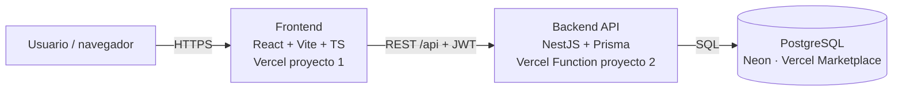

# Arquitectura objetivo

Diagrama editable: [`arquitectura.excalidraw`](arquitectura.excalidraw). Para abrirlo
ve a <https://excalidraw.com>, menú ☰ → **Abrir** y elige el archivo, o arrástralo
al lienzo. También puedes usar la extensión *Excalidraw* de VS Code
(`pomdtr.excalidraw-editor`) para editarlo dentro del repo.



## Estructura del monorepo (la crea `/speckit-implement`)
```
frontend/   React + Vite + TS (páginas, componentes, cliente API)
backend/    NestJS + Prisma (módulos auth, availability, tasks, schedule, stats)
specs/      Specs generadas por Spec Kit (spec, plan, tasks, contratos)
docs/       Producto, arquitectura y prompts
.specify/   Plantillas, scripts y constitución de Spec Kit
.claude/    Skills /speckit-* para Claude Code
```

## Decisiones iniciales
| Tema | Decisión | Motivo |
|------|----------|--------|
| Despliegue | Dos proyectos Vercel en el mismo repo (Root Directory `frontend` y `backend`) | Vercel ejecuta NestJS nativamente como Function; cada parte escala y se despliega por separado. |
| BD | Neon Postgres instalado desde Vercel Marketplace | Vercel Postgres ya no existe; Neon inyecta `DATABASE_URL` automáticamente en el proyecto. |
| ORM | Prisma | Migraciones versionadas y tipos generados para TypeScript. |
| Auth | Email + contraseña (bcrypt) y JWT en header `Authorization` | Suficiente para el MVP, sin proveedores externos. |
| Algoritmo de horario | Función pura en `backend/src/schedule/` con tests unitarios | Es el núcleo del producto; debe testearse sin BD. |

Estas decisiones se formalizan en la constitución y en el `plan.md` de la spec.
