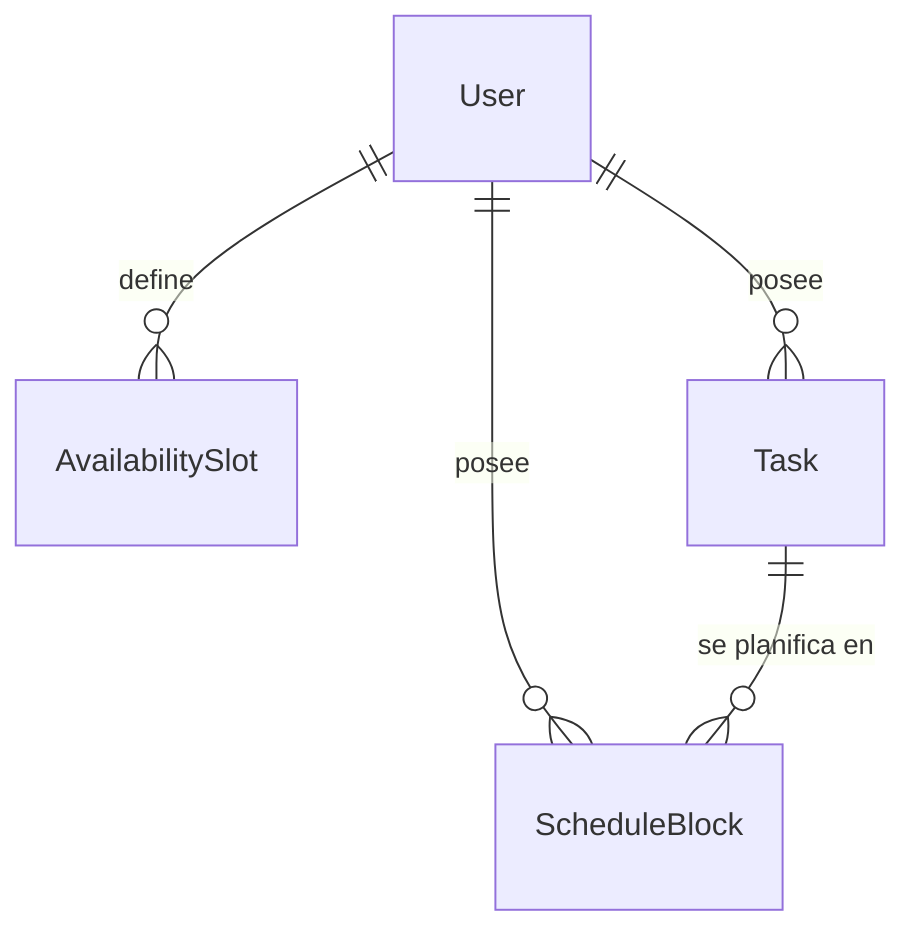

# Data Model: Mini-MVP Horario Productivo

**Feature**: `001-schedule-productivity-mvp` · **Spec**: [spec.md](spec.md) · **Research**: [research.md](research.md)

Persistencia en PostgreSQL mediante Prisma (`backend/prisma/schema.prisma`). Todos los
identificadores son UUID. Todas las fechas-hora son `timestamptz` (UTC). Los nombres de
modelo y de campo van en inglés (constitución).

## Diagrama



## Enums

| Enum | Valores | Uso |
|------|---------|-----|
| `Priority` | `HIGH`, `MEDIUM`, `LOW` | Prioridad de la tarea (alta/media/baja en la UI) |
| `TaskStatus` | `PENDING`, `DONE` | Estado de la tarea |
| `BlockStatus` | `PLANNED`, `COMPLETED`, `SKIPPED` | Estado del bloque (planificado/completado/omitido) |

## User

| Campo | Tipo | Reglas |
|-------|------|--------|
| `id` | uuid PK | |
| `email` | string, **unique** | Formato email válido; se guarda en minúsculas y sin espacios (FR-001) |
| `passwordHash` | string | bcrypt, coste 10; nunca se devuelve por la API |
| `timezone` | string | Zona IANA válida (p. ej. `America/La_Paz`); por defecto `UTC` si el navegador no la envía |
| `createdAt` | timestamptz | default `now()` |

## AvailabilitySlot

| Campo | Tipo | Reglas |
|-------|------|--------|
| `id` | uuid PK | |
| `userId` | uuid FK → User (onDelete Cascade) | |
| `weekday` | int | 1 (lunes) … 7 (domingo) |
| `startMinute` | int | 0 … 1425, múltiplo de 15 (FR-004) |
| `endMinute` | int | 15 … 1440, múltiplo de 15; `endMinute > startMinute`, es decir, no cruza la medianoche (FR-005) |
| `createdAt` | timestamptz | |

- **Índice**: `(userId, weekday, startMinute)`.
- **Regla de servicio**: no puede solaparse con otra franja del mismo usuario y día:
  `a.start < b.end && b.start < a.end` → `409 SLOT_OVERLAP` (FR-005).

## Task

| Campo | Tipo | Reglas |
|-------|------|--------|
| `id` | uuid PK | |
| `userId` | uuid FK → User (onDelete Cascade) | |
| `title` | string(120) | 1–120 caracteres tras `trim` |
| `durationMinutes` | int | 15 … 1440, múltiplo de 5 (FR-006) |
| `priority` | `Priority` | |
| `deadline` | date (sin hora), nullable | Interpretada como el final de ese día (23:59:59) en la zona del usuario |
| `category` | string(40), nullable | Texto libre, `trim`; vacío → null |
| `status` | `TaskStatus` | default `PENDING` |
| `completedAt` | timestamptz, nullable | Se fija al pasar a `DONE`; null al reabrir |
| `createdAt` / `updatedAt` | timestamptz | |

- **Índice**: `(userId, status)`.
- **Derivados** (no se almacenan, se calculan en la respuesta):
  - `completedMinutes` = Σ minutos de sus bloques `COMPLETED`.
  - `remainingMinutes` = `max(0, durationMinutes − completedMinutes)` (FR-007).
  - `overdue` = `status = PENDING` y el final del día `deadline` < ahora (en la zona del
    usuario).

### Transiciones de estado de Task

```text
PENDING ──(Σ completados ≥ duración, FR-008)──▶ DONE   (completedAt = now)
PENDING ──(PATCH status=DONE manual)──────────▶ DONE   (completedAt = now)
DONE    ──(PATCH status=PENDING manual)───────▶ PENDING (completedAt = null)
DONE    ──(bloque COMPLETED → otro estado y Σ < duración)──▶ PENDING (completedAt = null)
```

- Editar `durationMinutes` reevalúa la regla: si Σ completados ≥ nueva duración → `DONE`.
- Borrar una tarea borra sus bloques (onDelete Cascade, FR-009).

## ScheduleBlock

| Campo | Tipo | Reglas |
|-------|------|--------|
| `id` | uuid PK | |
| `userId` | uuid FK → User (onDelete Cascade) | Denormalizado para filtrar por usuario sin join |
| `taskId` | uuid FK → Task (onDelete Cascade) | |
| `startAt` | timestamptz | Múltiplo de 5 min |
| `endAt` | timestamptz | `endAt > startAt`; duración 5…50 min (25–50 salvo el resto final de una tarea) |
| `status` | `BlockStatus` | default `PLANNED` |
| `createdAt` / `updatedAt` | timestamptz | |

- **Índice**: `(userId, startAt)`.
- **Derivado**: `durationMinutes` = `(endAt − startAt)` en minutos.
- **Pertenencia a semana**: un bloque pertenece a la semana cuyo lunes local (zona del
  usuario) contiene `startAt`. Los bloques nunca cruzan la medianoche, porque las franjas
  no lo hacen.

### Transiciones de estado de ScheduleBlock

```text
PLANNED ⇄ COMPLETED ⇄ SKIPPED ⇄ PLANNED   (cualquier transición permitida, FR-019)
```

- Al entrar o salir de `COMPLETED` se recalcula el estado de la tarea (ver arriba).
- **Regenerar** (FR-016): borra los bloques `PLANNED` de la semana y conserva
  `COMPLETED` y `SKIPPED`, que se pasan al scheduler como `keptBlocks` (ocupan su hora +
  5 min de descanso).

## Tipos del dominio puro (no persistidos)

Usados por `scheduler.ts` y `stats.ts`; se definen en TypeScript, no en Prisma.

- **SchedulerInput**: `now: Date`, `timezone: string`, `weekStart: string (YYYY-MM-DD)`,
  `slots: {weekday, startMinute, endMinute}[]`,
  `tasks: {id, pendingMinutes, priority, deadline: string|null, createdAt: Date}[]`,
  `keptBlocks: {startAt: Date, endAt: Date}[]`.
- **ScheduleResult**: `blocks: {taskId, startAt, endAt}[]`,
  `unassigned: {taskId, minutes, reason: 'NO_SPACE' | 'NO_SPACE_BEFORE_DEADLINE'}[]`,
  `overdueTaskIds: string[]`.
- **WeekStatsInput**: `weekBlocks: {startAt, endAt, status}[]`,
  `tasksCompletedInWeek: number`, `completedBlockStarts: Date[]` (todos los bloques
  completados del usuario, para la racha), `now: Date`, `timezone: string`.
- **WeekStats**: `totalBlocks`, `completedBlocks`, `skippedBlocks`,
  `completionRate` (0–100, entero redondeado; 0 si no hay bloques), `plannedMinutes`,
  `completedMinutes`, `tasksCompleted`, `streakDays`.
  - **Racha** (FR-022): sea `D` el conjunto de fechas locales con al menos un bloque
    completado. Si hoy ∈ `D`, se cuenta desde hoy; si no, desde ayer. Se suman los días
    consecutivos hacia atrás mientras estén en `D`.
  - **tasksCompleted** (FR-021): tareas con `completedAt` dentro de
    `[weekStart 00:00, weekStart + 7d)` locales.
